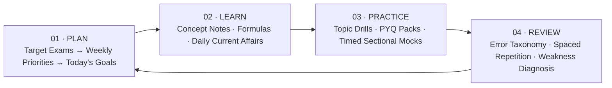
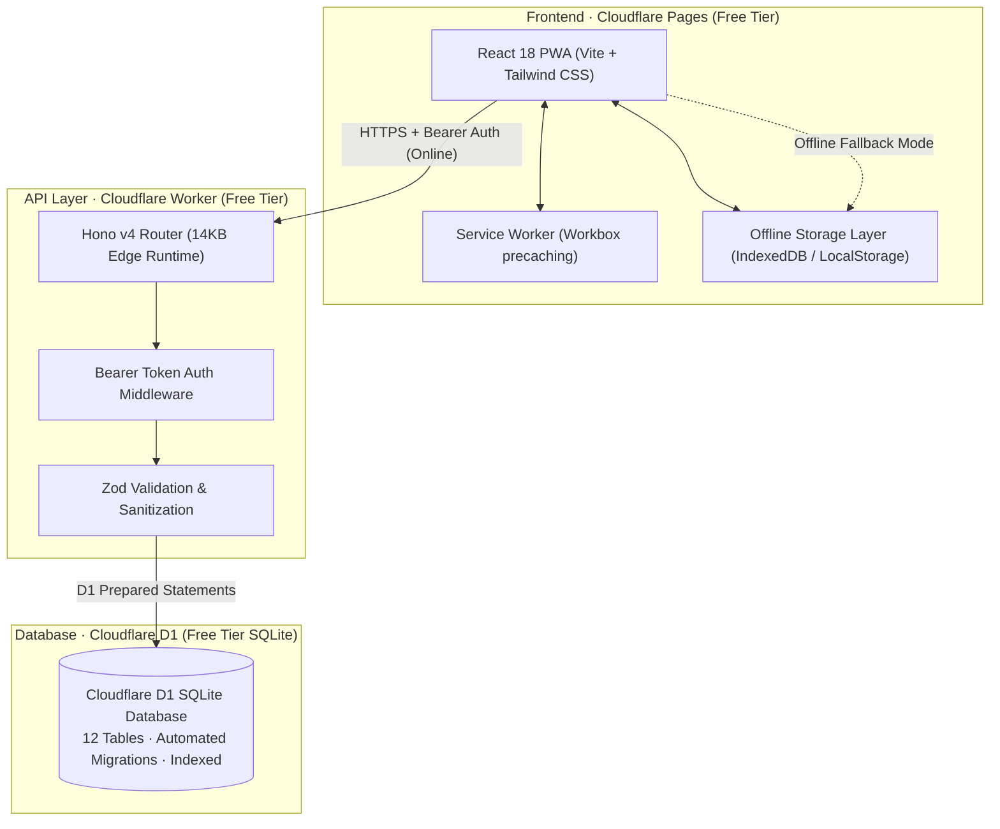
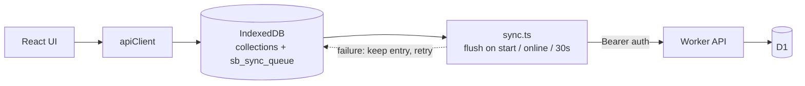

# Study Buddy (`study_buddy`)

> **Personal Competitive Exam Preparation Platform**  
> *A private, mobile-friendly preparation hub for SSC CGL, TNPSC Group 4 & 2/2A, IBPS (PO/Clerk/SO), and SBI (PO/Clerk).*

[](https://www.typescriptlang.org/)
[](https://react.dev/)
[](https://hono.dev/)
[](https://workers.cloudflare.com/)
[](https://tailwindcss.com/)
[](https://web.dev/progressive-web-apps/)
[-emerald.svg)](#zero-cost-operating-model)

---

## 1. Executive Summary & Product Vision

**Study Buddy** is an offline-first, mobile-first personal study operating system engineered for single-learner mastery of Indian national and Tamil Nadu state competitive examinations.

Competitive exam preparation in India is often derailed by cognitive overload, fragmented notes, chaotic revision cycles, and punitive streak counters. Study Buddy replaces stress with a calm, high-contrast, luxury-inspired study rhythm built around a 4-stage continuous learning loop:



---

## 2. System Architecture

Study Buddy uses a modern, ultra-lightweight TypeScript monorepo designed to operate indefinitely at **₹0 ongoing cost** on Cloudflare's global edge network.



### Core Design Decisions

| Layer | Technology | Key Reason | Free Tier Quota / Benefit |
|---|---|---|---|
| **Monorepo** | npm workspaces | Zero tooling overhead, unified types across client & server | Built-in Node.js capability |
| **Frontend** | React 18 + Vite 5 + Tailwind 3 | Instant HMR, minimal bundle size (80KB gzipped), tree-shakeable | Unlimited bandwidth & requests on Cloudflare Pages |
| **PWA Engine** | Vite Plugin PWA + Workbox | Full installability, offline shell caching, background resilience | Operates completely without internet connection |
| **Backend API** | Hono v4 on Cloudflare Workers | Edge execution, sub-10ms cold starts, zero dependency bloat | 100,000 requests/day free, 10ms CPU per request |
| **Database** | Cloudflare D1 (Serverless SQLite) | Direct SQL relational capabilities, transaction safety | 5 GB storage, 5,000,000 row reads/day, 100,000 writes/day |
| **Auth** | Bearer Secret Header | Private single-user access without requiring paid Auth0/Clerk | ₹0 cost, zero tracking cookies |

### Offline-First Data Flow

All writes land in IndexedDB first and are appended to a durable mutation queue; a background
worker drains that queue to the Cloudflare Worker when connectivity is available. Reads are
remote-first with an automatic local fallback, so the app behaves identically with the API
unreachable or `VITE_API_URL` unset.



- Queued mutations are removed **only after** a successful `{ success: true }` response.
- Client-generated UUIDs are honoured by the API, making replays idempotent.
- `sb_tests` + `sb_attempts` are submitted atomically through `/practice/tests/submit`.
- A status pill shows “Offline · saved on this device” or “Syncing N changes…”.

See [`docs/OFFLINE_SYNC.md`](./docs/OFFLINE_SYNC.md) for the full contract, endpoint map and
conflict policy.

---

## 3. Repository Structure

```
study-buddy/
├── package.json                   # Monorepo root workspace config & scripts
├── tsconfig.json                  # Root TypeScript configuration
├── AGENTS.md                      # AI & Agent pairing guidelines and protocol
├── PENDING_WORK.md                # Comprehensive backlog of Phases 2 through 5
├── docs/
│   └── ARCHITECTURE.md            # Deep-dive architecture, ER diagrams, data flow
├── shared/                        # Shared TypeScript schemas, types, and seed data
│   ├── package.json
│   ├── tsconfig.json
│   └── src/
│       ├── index.ts               # Barrel exports
│       ├── types.ts               # Universal domain models & API response interfaces
│       └── seed-data.ts           # Exams, subjects, and 45+ hierarchical topics
└── packages/
    ├── api/                       # Cloudflare Workers Edge API (Hono)
    │   ├── package.json
    │   ├── tsconfig.json
    │   ├── wrangler.toml          # Cloudflare Worker & D1 binding configuration
    │   └── src/
    │       ├── index.ts           # App entry point, CORS, error handling, route mounting
    │       ├── types.ts           # Worker environment bindings
    │       ├── middleware/
    │       │   └── auth.ts        # Bearer token security check
    │       ├── db/
    │       │   ├── mappers.ts     # Snake_case DB to camelCase model mappers
    │       │   └── migrations/
    │       │       ├── 0001_initial_schema.sql      # 12 core relational tables, FKs & checks
    │       │       ├── 0002_seed_data.sql           # Seed data for exams and taxonomy
    │       │       └── 0003_integrity_indexes.sql   # Idempotent upgrade for existing databases
    │       ├── validation/
    │       │   └── schemas.ts     # Zod runtime validators
    │       └── routes/
    │           ├── dashboard.ts   # GET /api/dashboard aggregate payload
    │           ├── sessions.ts    # CRUD /api/sessions (daily logs)
    │           ├── goals.ts       # CRUD /api/goals & /carry-forward
    │           ├── exams.ts       # Target exam priority and date management
    │           ├── taxonomy.ts    # Subjects and topics lookup
    │           ├── questions.ts   # Question pack import & delete
    │           ├── practice.ts    # Test submission + attempt/mistake derivation
    │           ├── mistakes.ts    # Mistake book filters & classification
    │           ├── revisions.ts   # SM-2 review & reschedule endpoints
    │           ├── notes.ts       # Notebook & current affairs CRUD
    │           ├── bookmarks.ts   # Bookmark create/list/delete
    │           └── backup.ts      # Full JSON database export and restore
    └── web/                       # React 18 Progressive Web App
        ├── package.json
        ├── tsconfig.json
        ├── vite.config.ts         # Vite build config, path aliases & PWA generator
        ├── tailwind.config.js     # Dark luxury palette & typographic scale
        ├── index.html             # HTML5 app shell (system fonts, no external requests)
        ├── public/
        │   ├── favicon.svg        # SVG app icon
        │   ├── pwa-192x192.png    # PWA icon (any)
        │   ├── pwa-512x512.png    # PWA icon (any + maskable)
        │   ├── apple-touch-icon.png
        │   ├── _redirects         # Cloudflare Pages SPA fallback
        │   └── _headers           # CSP, caching and security headers
        └── src/
            ├── main.tsx           # React root, ErrorBoundary, background sync bootstrap
            ├── App.tsx            # Application routing (React Router v6)
            ├── index.css          # Tailwind directives, markdown & KaTeX styles
            ├── components/
            │   ├── Layout.tsx     # Responsive desktop sidebar / mobile bottom nav
            │   ├── Sidebar.tsx    # Desktop fixed navigation rail
            │   ├── BottomNav.tsx  # Mobile glassmorphic bottom bar
            │   ├── Markdown.tsx   # Offline Markdown + KaTeX renderer
            │   ├── NetworkStatus.tsx # Offline / pending-sync pill
            │   ├── ErrorBoundary.tsx
            │   └── ui/            # Accessible atomic design system
            ├── lib/
            │   ├── utils.ts       # Dates, formatters, ids, Fisher–Yates shuffle
            │   ├── storage.ts     # IndexedDB repository + sync queue + localStorage fallback
            │   ├── http.ts        # Base URL, Bearer auth, typed API results
            │   ├── sync.ts        # Queue processor & background flush triggers
            │   ├── useOnlineStatus.ts
            │   └── api.ts         # Local-first API client with remote read-through
            └── features/
                ├── dashboard/     # Today screen, Daily Plan, Weekly Stats
                ├── tracker/       # Daily study log (time, accuracy, reflections)
                ├── goals/         # Today & tomorrow goal setting with carry-forward
                ├── practice/      # Quiz config, runner (KaTeX) and result summary
                ├── library/       # Question bank browser & JSON pack importer
                ├── revision/      # Spaced review queue, mistake book, classifier
                ├── progress/      # Consistency charts & weak-area diagnosis
                ├── notes/         # Markdown notebook & dated current affairs
                ├── search/        # Global offline search across all collections
                ├── NotFoundPage.tsx
                └── settings/      # JSON export, file restore, and state reset
```

---

## 4. Visual Design System

The application strictly adheres to a **calm, focused, dark-mode luxury aesthetic**:
- **Background Surfaces**: Pure near-black (`#0a0a0a`), card background (`#141414`), elevated surface (`#1a1a1a`), hover states (`#1e1e1e`), and hairline borders (`#2a2a2a`).
- **Typography & Text**: High-contrast white (`#f0f0f0`), secondary warm gray (`#a0a0a0`), and muted hints (`#707070`).
- **Accent System**: Restrained electric sapphire (`#6b8afd`) with subtle glowing borders (`rgba(107, 138, 253, 0.15)`). No noisy rainbow gradients or dopamine-trap gamification.
- **Responsiveness**:
  - **Desktop (≥ 768px)**: Fixed 64-column left navigation rail, expanded 2-column dashboard layout.
  - **Mobile (< 768px)**: Thumb-friendly top action bar, full-width card layout, and fixed glassmorphic bottom navigation.

---

## 5. Getting Started (Local Development)

### Prerequisites
- **Node.js**: v20.0.0 or higher (Tested on Node.js v26)
- **npm**: v10.0.0 or higher

### 1. Installation
Clone the repository and install workspace dependencies:
```bash
cd study-buddy
npm install
```

### 2. Run Typecheck, Tests & Build
Verify that the shared models, API, and web packages build cleanly:
```bash
# Verify TypeScript compilation across all packages
npm run typecheck

# Run the Vitest unit suite (validation, schemas, utilities)
npm test

# Build the production PWA bundle (including Service Worker)
npm run build

# Or all three in sequence
npm run verify
```

### 3. Start Development Servers

#### Launch the Web PWA Frontend:
```bash
npm run dev
# Running at http://localhost:5173
```

#### Launch the Edge API Worker (with local D1 simulation):
```bash
npm run dev:api
# Running at http://localhost:8787
```

To connect the frontend to the Worker locally, create `packages/web/.env.local`:
```env
VITE_API_URL=http://localhost:8787
VITE_API_TOKEN=<the API_TOKEN you set for the Worker>
```

If `VITE_API_URL` is omitted the app runs in standalone offline mode — every feature still works.

---

## 6. Zero-Cost Production Deployment (₹0 / month)

This platform is engineered specifically for a single-person deployment at absolute zero cost.

### Step 1: Initialize Cloudflare D1 Database
Install Wrangler globally or use `npx wrangler`:
```bash
# Log into your free Cloudflare account
npx wrangler login

# Create the remote D1 SQLite database
npx wrangler d1 create study-buddy-db
```
Wrangler will output your unique `database_id`. Paste it into `packages/api/wrangler.toml`:
```toml
[[d1_databases]]
binding = "DB"
database_name = "study-buddy-db"
database_id = "YOUR_ACTUAL_D1_DATABASE_ID_HERE"
migrations_dir = "src/db/migrations"
```

### Step 2: Apply Database Migrations
```bash
cd packages/api
npx wrangler d1 migrations apply study-buddy-db --remote
```
This automatically provisions all 12 tables and seeds default Indian competitive exams (SSC CGL, TNPSC Group 4/2, IBPS, SBI) and 45+ syllabus topics.

### Step 3: Configure Single-User API Secret
Set an unguessable token on your Cloudflare Worker:
```bash
npx wrangler secret put API_TOKEN
# Enter a secure passphrase when prompted (e.g., a 32-character random string)
```

### Step 4: Deploy Cloudflare Worker API
```bash
npx wrangler deploy
# Deployed to https://study-buddy-api.<your-cloudflare-subdomain>.workers.dev
```

### Step 5: Deploy Frontend to Cloudflare Pages
Connect your GitHub repository to **Cloudflare Pages** (Free Tier):
- **Framework preset**: `Vite`
- **Root directory**: `packages/web`
- **Build command**: `npm run build`
- **Build output directory**: `dist`
- **Environment variables**:
  - `VITE_API_URL`: `https://study-buddy-api.<your-subdomain>.workers.dev`
  - `VITE_API_TOKEN`: `<your-secure-token>`

Your app will be live on `https://study-buddy.pages.dev` with free SSL and worldwide edge caching.

---

## 7. Data Portability & Privacy

- **Data Sovereignty**: The user owns 100% of their study data. Navigate to **Settings → Backup & Export** to download a single, uncompressed, fully documented `study-buddy-backup.json` file at any time.
- **Independent Restoration**: In the event of an environment wipe or device change, simply click **Import Backup JSON** to restore all sessions, goals, attempts, and notes with automated schema validation.
- **Zero Third-Party Tracking**: No telemetry, no third-party analytics scripts, no external fonts loaded in production, no tracking cookies.

---

## 8. Development Roadmap

For the detailed backlog of remaining polish items, see [`PENDING_WORK.md`](./PENDING_WORK.md).
Release history lives in [`CHANGELOG.md`](./CHANGELOG.md).

- **Phase 1: Foundation & Daily Study Loop** *(Status: Completed)*
  - PWA shell, dark luxury theme, responsive layout.
  - Complete Today dashboard, daily session tracker, goal management with carry-forward, 25m Pomodoro sprint timer.
  - Cloudflare D1 schema (12 tables), Hono edge API, and offline-first IndexedDB fallback.
- **Phase 2: Question Library & Practice Engine** *(Status: Completed)*
  - Schema-validated JSON question pack importer with row-level error reporting.
  - Multi-faceted question bank browser with instant search, filters, and bookmarking.
  - Interactive test runner with Practice Mode (instant explanations) and Timed Exam Mode.
- **Phase 3: Mistake Book & Mock Analysis** *(Status: Completed)*
  - Post-test diagnostic breakdown (score, pace, unanswered items, sectional accuracy).
  - Error classification (concept gap, calculation, misread, guess, time pressure).
- **Phase 4: Spaced Repetition Revision & Weak-Area Diagnosis** *(Status: Completed)*
  - Modified SM-2 queue (1, 3, 7, 14, 30 days) with non-punitive backlog handling.
  - Topic diagnosis with a 15-attempt sample-size safeguard and persistent dismissals.
- **Phase 5: Study Notebook, Current Affairs & Polish** *(Status: Completed)*
  - Markdown notebook with live preview and KaTeX formula rendering.
  - Dated current affairs feed with source attribution and a pre-filtered recall quiz.
  - Global offline search across questions, notes, mistakes and sessions.
  - Offline mutation queue, background sync, and a connectivity/sync status indicator.
- **Hardening (v1.1.0)** *(Status: Completed)*
  - IndexedDB lifecycle fix + one-time localStorage migration.
  - Idempotent API writes (client ids), Bookmarks API, schema integrity migration.
  - PWA icons, SPA `_redirects`, security `_headers`, offline deep links.
  - ErrorBoundary, 404 page, Vitest suite and GitHub Actions CI.
