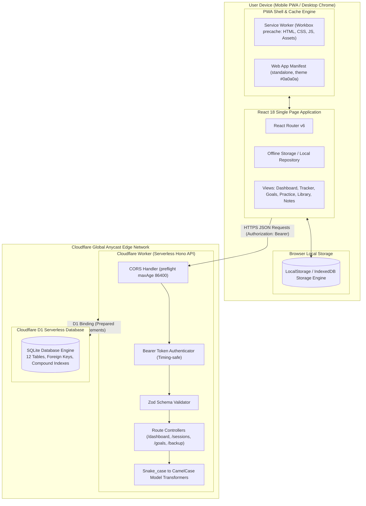
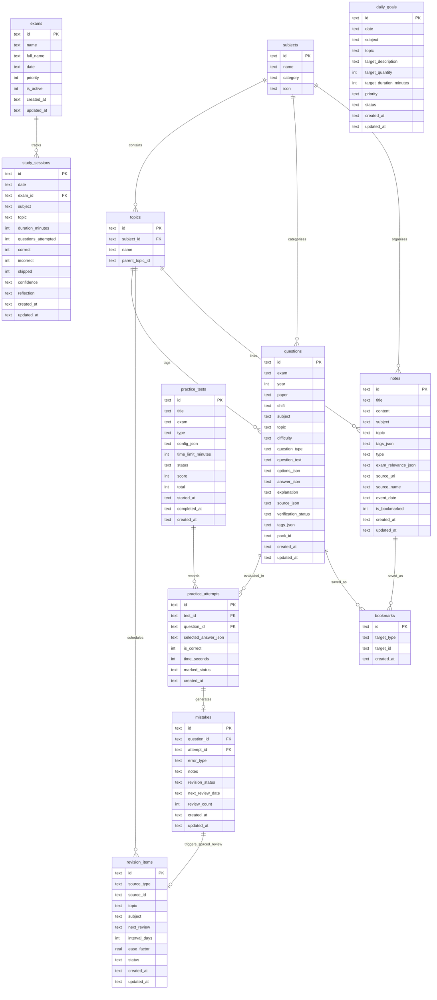

# System Architecture & Technical Specifications

> **Study Buddy: Personal Competitive Exam Preparation Platform**  
> *Architectural Specification, Data Contracts, Storage Strategies, and Edge Deployment Model.*

---

## 1. Architectural Philosophy & Constraints

Study Buddy is architected for a **single ambitious learner** targeting premier Indian government and banking exams (SSC CGL, TNPSC Group 4 & 2/2A, IBPS, SBI).

The architecture adheres to three inviolable constraints:
1. **Absolute ₹0 Cost**: Zero paid APIs, zero subscriptions, zero paid database instances, zero paid domains.
2. **Offline-First Resilience**: An intermittent internet connection or rural study environment must never block question practice, note review, or session logging.
3. **Data Sovereignty**: The learner's work is stored in standard relational structures (SQLite) and can be completely exported to human-readable JSON at any time.

---

## 2. High-Level Topology



---

## 3. Entity-Relationship Data Model

The D1 database schema consists of 12 tables interconnected via relational keys and indexed for low-latency queries under high question volume.



### Table Indexing Strategy

To guarantee sub-10ms response times within Cloudflare Workers' free CPU quota, the following indexes are baked into `0001_initial_schema.sql`:

```sql
CREATE INDEX idx_questions_exam_subject_topic ON questions(exam, subject, topic);
CREATE INDEX idx_study_sessions_date ON study_sessions(date);
CREATE INDEX idx_daily_goals_date_status ON daily_goals(date, status);
CREATE INDEX idx_practice_attempts_test_id ON practice_attempts(test_id);
CREATE INDEX idx_mistakes_question_id ON mistakes(question_id);
CREATE INDEX idx_revision_items_next_review_status ON revision_items(next_review, status);
CREATE INDEX idx_notes_subject_topic_type ON notes(subject, topic, type);
CREATE INDEX idx_bookmarks_target ON bookmarks(target_type, target_id);
```

---

## 4. API Endpoints & Contract Specification

All `/api/*` endpoints require the header `Authorization: Bearer <API_TOKEN>`. Responses strictly adhere to `ApiResponse<T>`:

```typescript
interface ApiResponse<T> {
  success: boolean;
  data?: T;
  error?: string;
  errors?: Array<{ field: string; message: string; row?: number }>;
}
```

### Route Registry

| Method | Endpoint | Description | Query / Body Payload | Response Model |
|---|---|---|---|---|
| `GET` | `/` | API Information & Health | None | Metadata JSON |
| `GET` | `/health` | Cloudflare Edge Liveness Check | None | `{ status: "ok" }` |
| `GET` | `/api/dashboard` | Aggregated view for Today screen | None | `DashboardData` |
| `GET` | `/api/sessions` | Fetch paginated study sessions | `?date=YYYY-MM-DD&page=1&pageSize=20` | `PaginatedResponse<StudySession>` |
| `POST` | `/api/sessions` | Log a completed study session | `CreateSessionSchema` | `ApiResponse<StudySession>` |
| `PUT` | `/api/sessions/:id` | Update session details | `UpdateSessionSchema` | `ApiResponse<StudySession>` |
| `DELETE` | `/api/sessions/:id` | Remove a session entry | None | `ApiResponse<{ id: string }>` |
| `GET` | `/api/goals` | Filtered goal list | `?date=YYYY-MM-DD&status=planned` | `ApiResponse<DailyGoal[]>` |
| `POST` | `/api/goals` | Create a new daily target | `CreateGoalSchema` | `ApiResponse<DailyGoal>` |
| `PUT` | `/api/goals/:id` | Update goal status or details | `UpdateGoalSchema` | `ApiResponse<DailyGoal>` |
| `DELETE` | `/api/goals/:id` | Delete a scheduled goal | None | `ApiResponse<{ id: string }>` |
| `POST` | `/api/goals/carry-forward` | Advance overdue goals to today | None | `ApiResponse<{ updated: number }>` |
| `GET` | `/api/exams` | List all tracked exams | None | `ApiResponse<Exam[]>` |
| `PUT` | `/api/exams/:id` | Update target exam date/priority | `UpdateExamSchema` | `ApiResponse<Exam>` |
| `GET` | `/api/subjects` | List core subjects | None | `ApiResponse<Subject[]>` |
| `GET` | `/api/topics` | List topics for subject | `?subjectId=quantitative` | `ApiResponse<Topic[]>` |
| `GET` | `/api/backup/export` | Full database export | None | `ApiResponse<BackupData>` |
| `POST` | `/api/backup/import` | Validate & restore database | `BackupData` | `ApiResponse<{ imported: Record<string, number> }>` |

---

## 5. Security & Single-User Access Model

Because Study Buddy is designed for personal preparation without recurring SaaS expenses:
- **No Paid Identity Provider**: Services like Auth0, Clerk, or Firebase Auth are excluded.
- **Bearer Token Guard**: The Hono API layer intercepts every mutation and query with `authMiddleware`:
  ```typescript
  export const authMiddleware: MiddlewareHandler<{ Bindings: Env }> = async (c, next) => {
    if (c.req.method === 'OPTIONS') return next();
    const expectedToken = c.env.API_TOKEN;
    if (!expectedToken) return next(); // Permissive local dev fallback

    const authHeader = c.req.header('Authorization');
    const token = authHeader?.startsWith('Bearer ') ? authHeader.slice(7) : null;
    if (!token || token !== expectedToken) {
      return c.json({ success: false, error: 'Unauthorized access' }, 401);
    }
    await next();
  };
  ```
- **Optional Cloudflare Access (Zero Trust)**: For users wanting UI-level authentication on `study-buddy.pages.dev`, Cloudflare Zero Trust (Free for up to 50 users) can be layered in front of the Cloudflare Pages subdomain with email OTP login without modifying code.

---

## 6. Offline-First & Synchronization Strategy

Study Buddy utilizes a dual-tier storage strategy:
1. **Tier 1 (Browser Runtime - Active)**: `storage.ts` provides instant synchronous CRUD across browser sessions using LocalStorage and IndexedDB fallback. When the device is offline, all actions succeed instantly with zero loading spinners or network timeouts.
2. **Tier 2 (Cloudflare D1 - Edge Synced)**: When connected, `apiClient` performs bidirectional sync with Cloudflare D1.
3. **Fail-Safe Portability**: The full database can be exported as a raw `.json` file at any second and restored on another machine, ensuring that platform changes or Cloudflare outages never risk user data.
